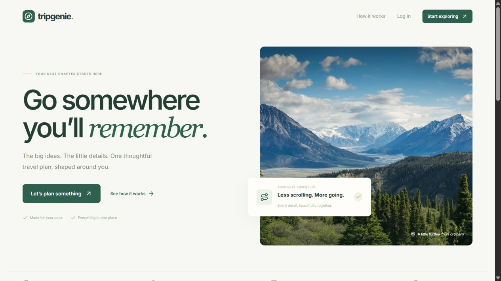
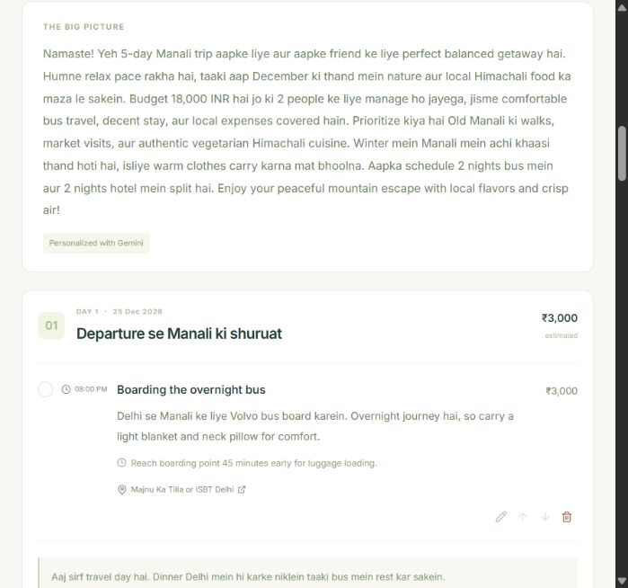
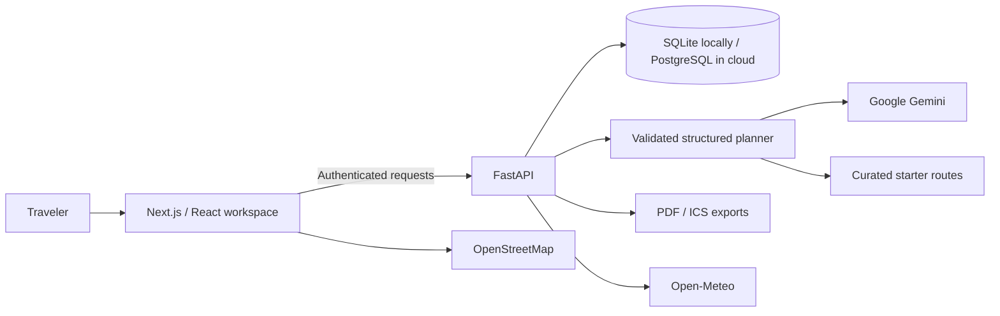

<div align="center">

# 🌿 TripGenie
### A thoughtful travel workspace, from the first idea to the last day.

Plan the route. Understand the budget. Keep the whole journey together.


**[Open the live app](https://tripgenie-escape.vercel.app)** · [Features](#what-you-can-do) · [Quick start](#run-locally) · [Architecture](#how-it-fits-together) · [Deployment](docs/DEPLOYMENT.md) · [Contributing](CONTRIBUTING.md)

</div>



<details>
<summary><strong>Inside a detailed trip workspace</strong></summary>



</details>

## The idea

Travel planning usually ends with scattered messages, a rough budget, and a document that is hard to update. TripGenie puts the itinerary, journey logistics, expenses, packing list, notes, and trip conversation in one saved workspace.

Tell it where you are starting, your dates, group size, budget, interests, and preferred language. It builds a detailed plan that you can refine through conversation or edit yourself.

> **Example:** Delhi → Manali · 2 travelers · ₹18,000 group budget · 5 days. The plan accounts for outbound and return journeys, hotel versus overnight transit nights, timed activities, local travel tips, itemized costs, booking tasks, and alternatives.

## What you can do

| Area | Included |
| :--- | :--- |
| **Your account** | Register, sign in, update your profile, save preferences, change your password |
| **Trip collection** | Search, upcoming/past/archived filters, duplicate, archive and restore |
| **Guided planning** | Three-step wizard: origin, destination, dates, travelers, interests and group budget |
| **Detailed itineraries** | Journey segments, timed activities, descriptions, transit tips and overnight stays |
| **Night accounting** | Separate hotel nights and overnight travel, aligned with selected dates |
| **Budget workspace** | Quantity × rate line items, category totals, recorded expenses and per-person split |
| **Trip assistant** | Saved conversation and itinerary updates in English or Roman-script Hinglish |
| **Your edits** | Add, edit, remove, reorder and complete activities |
| **Practical details** | Packing checklist, private notes, booking checklist and backup options |
| **Destination context** | OpenStreetMap view, map search links and current seven-day weather |
| **Sharing** | Revocable read-only itinerary links excluding private workspace data |
| **Exports** | PDF itinerary, ICS calendar and workspace JSON |

A quiet travel-inspired palette, local photography, responsive navigation, keyboard-accessible dialogs and subtle motion with reduced-motion support make the workspace comfortable to use.

## How it fits together



**Frontend:** Next.js 16 App Router, React 19, strict TypeScript, Tailwind CSS and Lucide icons.

**Backend:** Python, FastAPI, SQLAlchemy, Pydantic, JWT authentication, google-genai and ReportLab. Local development uses SQLite; cloud hosting uses persistent PostgreSQL through psycopg.

### Planning that can recover

1. The API saves the trip and accepts generation with `202`.
2. The workspace polls the saved trip while a background task prepares the itinerary.
3. Gemini returns a structured response validated against the itinerary schema. Selected dates, night counts and budget calculations are checked.
4. Each model attempt is bounded to 30 seconds, with one attempt per model. The default chain contains two models.
5. An unavailable provider produces an explicitly labeled curated starter plan. Failed chat updates preserve the existing itinerary.
6. Cancellation invalidates the job token, so an old result cannot replace a newer or cancelled plan. Stale jobs recover after 95 seconds.

These are bounded in-process tasks, not a durable queue. A host restart can interrupt generation; the saved workspace remains available and the user can retry.

## Run locally

### Prerequisites

- **Node.js 22** recommended; Next.js requires at least Node 20.9.
- **Python 3.10+**; CI and cloud configuration use Python 3.12.
- A **Gemini API key** for model-generated itineraries. Starter plans work without one.

### 1. Get the code

```powershell
git clone https://github.com/agrimjain10/tripgenie.git
cd tripgenie
```

### 2. Start the backend

```powershell
cd backend
py -m venv .venv
.\.venv\Scripts\python.exe -m pip install -r requirements.txt
Copy-Item .env.example .env
# Open .env and set GEMINI_API_KEY and a long random JWT_SECRET.
.\.venv\Scripts\python.exe -m uvicorn main:app --reload --host 127.0.0.1 --port 8000
```

Copy the example only when `.env` does not already exist. Generate a secret with `python -c "import secrets; print(secrets.token_urlsafe(48))"` and paste it into the file. Never commit that file.

### 3. Start the frontend in another terminal

```powershell
cd frontend
Copy-Item .env.local.example .env.local
npm ci
npm run dev
```

Open **[localhost:3000](http://localhost:3000)**. Backend health: **[127.0.0.1:8000/api/health](http://127.0.0.1:8000/api/health)**. Interactive API documentation: **[127.0.0.1:8000/docs](http://127.0.0.1:8000/docs)**.

<details>
<summary><strong>macOS / Linux equivalents</strong></summary>

Use `python3 -m venv .venv`, `.venv/bin/python -m pip install -r requirements.txt`, `cp .env.example .env`, and `.venv/bin/python -m uvicorn main:app --reload --port 8000`. Frontend commands are identical; use `cp` to copy its environment example.

</details>

### Local production mode

Run `npm run build` followed by `npm run start` in `frontend`. On Windows, root `./start.ps1` starts the installed services in hidden processes, builds the frontend if needed, and writes logs to `.run/`.

## Environment variables

| Variable | Where | Purpose |
| :--- | :--- | :--- |
| `GEMINI_API_KEY` | Backend only | Gemini credential; never expose in browser code |
| `GEMINI_MODEL` | Backend | Primary model; example uses `gemini-3.1-flash-lite` |
| `GEMINI_FALLBACK_MODELS` | Backend | Optional comma-separated fallback model IDs |
| `JWT_SECRET` | Backend | Long random signing secret |
| `FRONTEND_URL` | Backend | Exact allowed browser origins, comma-separated |
| `DATABASE_URL` | Backend | Optional locally; persistent PostgreSQL required in cloud |
| `NEXT_PUBLIC_API_URL` | Frontend build | `/` in cloud for the same-origin API proxy; backend origin for direct local calls |
| `BACKEND_API_URL` | Frontend server/build | Backend HTTPS origin used by Next.js rewrites |

Templates: [`backend/.env.example`](backend/.env.example), [`frontend/.env.local.example`](frontend/.env.local.example). Credentials, logs and databases are excluded from Git.

## Project structure

```text
tripgenie/
├── docs/quality-checks.yml.example # Optional GitHub Actions workflow template
├── backend/
│   ├── main.py                 # Routes, jobs, workspace and external data
│   ├── ai_service.py           # Gemini generation and structured validation
│   ├── starter_service.py      # Curated fallback journeys
│   ├── auth.py                 # Password hashing and JWT ownership checks
│   ├── database.py             # SQLite / PostgreSQL connections
│   ├── models.py               # User and Trip persistence
│   ├── schemas.py              # Request / response validation
│   ├── pdf_service.py          # Printable itinerary layout
│   └── tests/test_flows.py      # Integration tests with temporary databases
├── frontend/
│   ├── app/                    # Landing, auth, dashboard, trips, explore, settings
│   ├── components/trip/        # Itinerary, budget, journey, map and workspace
│   ├── components/AppShell.tsx # Navigation and account context
│   ├── lib/                    # Typed API client and destination presets
│   └── public/images/          # Local travel photos
├── docs/DEPLOYMENT.md           # Hosting and future update workflow
├── scripts/check_repository.py # Tracked-file credential / data check
├── CONTRIBUTING.md
└── start.ps1                   # Windows production launcher
```

## Quality checks

```powershell
cd backend
.\.venv\Scripts\python.exe -m unittest discover -s tests -v
cd ../frontend
npm run typecheck
npm run build
```

Integration coverage includes authorization and ownership, generation, dates, budget arithmetic, cancellation races, conversations, manual edits, expense validation, sharing privacy/revocation, exports, duplication/archive, profiles and password updates. Tests use temporary databases and mocked providers.

Vercel runs its build checks on each deployment. An additional GitHub Actions template is supplied in `docs/quality-checks.yml.example`; move it to `.github/workflows/ci.yml` after granting the publishing credential the `workflow` scope. Live smoke tests additionally verify the configured database and provider.

## Deployment and future updates

Follow **[the deployment guide](docs/DEPLOYMENT.md)** for two Git-linked Vercel projects and persistent Neon PostgreSQL. Pushes to `main` trigger automatic deployments; pull requests can receive previews.

```powershell
git add .
git commit -m "Describe the change"
git push origin main
```

Check changes before pushing and keep secrets in hosting settings. Production has a separate database; local accounts and trips are not automatically uploaded.

## Practical boundaries

- Travel costs are estimates, not live fares. The app does not book transport/accommodation or process payments.
- Weather is the current seven-day forecast, not a prediction for arbitrary future dates.
- Gemini availability, quotas and prices depend on the Google project and model.
- Free hosting has compute, request, storage and fair-use limits. **Free does not mean unlimited.** Vercel Hobby is for personal, non-commercial projects.
- Tokens currently use browser local storage. Before a wider public launch, consider HttpOnly sessions, rate limiting, email verification, password recovery, monitoring and a durable queue.
- Small additive migrations preserve local work. Significant production schema changes should use reviewed, versioned migrations.

## Credits

Built by **Agrim Jain**. Photography is bundled locally from Unsplash. Forecasts: [Open-Meteo](https://open-meteo.com/). Maps: [OpenStreetMap contributors](https://www.openstreetmap.org/copyright). Attribution appears in the relevant panels.

No open-source license is granted at present. Contact the owner before reusing or redistributing the code.
